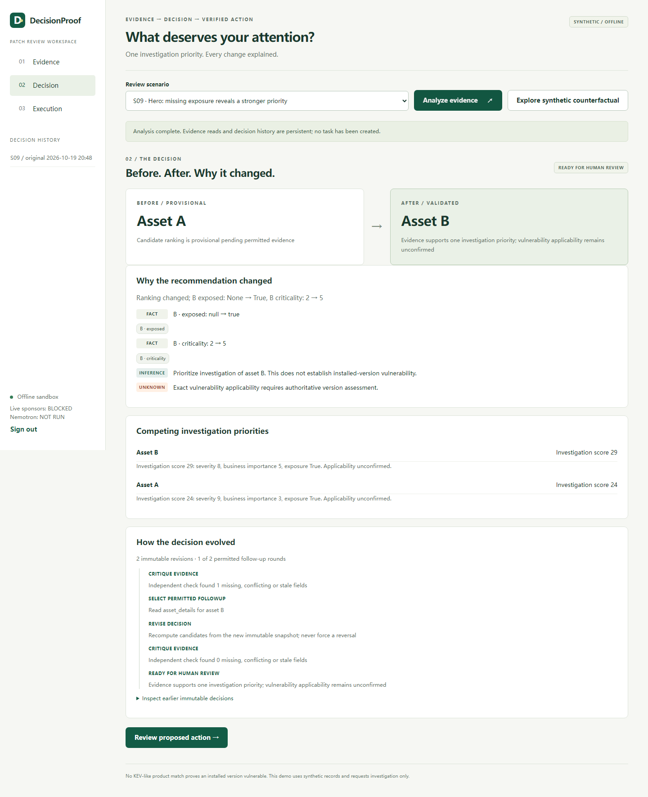

# DecisionProof Agent — Patch Review

**An offline evidence-to-action workspace for one IT generalist.** It detects missing/conflicting evidence, performs at most two permitted fixture reads, revises its investigation priority, and creates one explicitly approved/authorized sandbox task through the real pinned Agentic Intent Gate v0.2.0.

This P1A build uses **entirely synthetic evidence and deterministic planning**. It does not run Zetaris, Nemotron or Meterless, patch/scan a device, or write an external ticket. Sponsor-live readiness remains **BLOCKED**; Cursor use is **NOT_RUN**. Early development is [owner-reported permission, not written organizer confirmation](docs/EARLY_DEVELOPMENT_PERMISSION.md). No claim of competition eligibility or new in-window work is made.



## Run locally

Requirements: Python 3.13, Git, uv. In PowerShell from this repository:

```powershell
uv sync --locked --python 3.13 --link-mode copy
$sandbox = Join-Path (Get-Location) ('.preflight\manual-' + [guid]::NewGuid().ToString('N'))
uv run --locked python -m decisionproof init --directory $sandbox
uv run --locked python -m decisionproof serve --directory $sandbox --predecessor-stopped
```

Initialization prompts privately for your own 12+ character password. Open **http://127.0.0.1:8765** and sign in. `--predecessor-stopped` is your attestation that no prior process owns this directory; it never stops another process. On restart use the same private directory only after the prior owner has stopped. Keep one worker and localhost binding. Do not publish this local development transport.

Choose **S09** and analyze. Initially A is first; missing B exposure triggers `asset_details(B)`. The acquired synthetic exposure and importance evidence makes B first. Inspect **Before → After → Why changed**, provenance and remaining uncertainty, then use separate **Propose Plan → Approve → Admit → Authorize → Execute once** controls. The persisted task/receipt survives reload and restart. S12 demonstrates denied authorization; S08 abstains and cannot create a Plan. **Explore synthetic counterfactual** creates a separate labeled case, preserving original evidence/approvals.

Every reset is a new empty private directory, not a database reset. Unknown can mean a task exists despite an uncertain Action outcome; no retry control is offered. Never reset/replay an existing Unknown.

## Verify

```powershell
uv run --locked python -m pytest tests/test_product.py tests/test_contract_security.py -q
uv run --locked python -m decisionproof.evaluation
uv run --locked python -m playwright install chromium
uv run --locked python -m scripts.run_browser_check
uv lock --check --offline
uv pip check
```

The browser test is genuine headless Chromium against a fresh authenticated localhost server, with external requests blocked. It covers success, refusal, abstention, reload and a new server process. Reviewers' authenticated clicks are scripted in tests; an actual owner click or live-model result is not fabricated. Full installed-dependency qualification also uses `tests/preflight`; supply `P0_AIG_REFERENCE` as documented in [environment setup](docs/ENVIRONMENT_SETUP.md) to run the entire suite.

The 16 frozen synthetic scenarios are compared under severity-only proposal, full context without follow-up, and bounded follow-up. Actual results and limitations: [ABLATION_EVALUATION.md](docs/ABLATION_EVALUATION.md). These are not measured business savings or generalizable model accuracy.

## Design and review

- [P1A execution report and acceptance gates](docs/P1A_EXECUTION_REPORT.md)
- [Implemented reasoning architecture](docs/AGENT_REASONING_ARCHITECTURE.md), [Decision Delta](docs/DECISION_DELTA_SPEC.md)
- [Security and execution boundary](docs/SECURITY_MODEL.md), [provider-neutral sponsor contracts](docs/SPONSOR_INTEGRATION_CONTRACTS.md)
- [Approximately three-minute storyboard](docs/HERO_DEMO_STORYBOARD.md), [competition evidence map](docs/COMPETITION_SCORE_STRATEGY.md)
- [Historical P0 report](docs/P0_EXECUTION_REPORT.md), [pre-existing dependency disclosure](docs/templates/REUSE_DISCLOSURE.md)

AIG is pre-existing infrastructure, MIT, `agentic-intent-gate==0.2.0`, fixed Git commit **`7261fdd2f47d2b15fabe8faac527eeee37338eb1`**. Its public API provides Plan validation, exact approval binding, independent authorization, durable claim and fail-closed execution. The consumer implements evidence acquisition, decision memory/UI/auth and its narrow task/receipt store. Core source is not copied or changed. No v0.3, dynamic tools, general multi-agent framework or extended action budget is used.

Source/license: [MIT](LICENSE). Dependencies and versions are locked in [uv.lock](uv.lock). Prepare a sanitized review archive with `uv run --locked python scripts/package_p1a.py`; private state, credentials, environments and raw server logs are excluded. No commit, push, paid resource, public deployment or HackOS submission is performed by the verification commands above.
