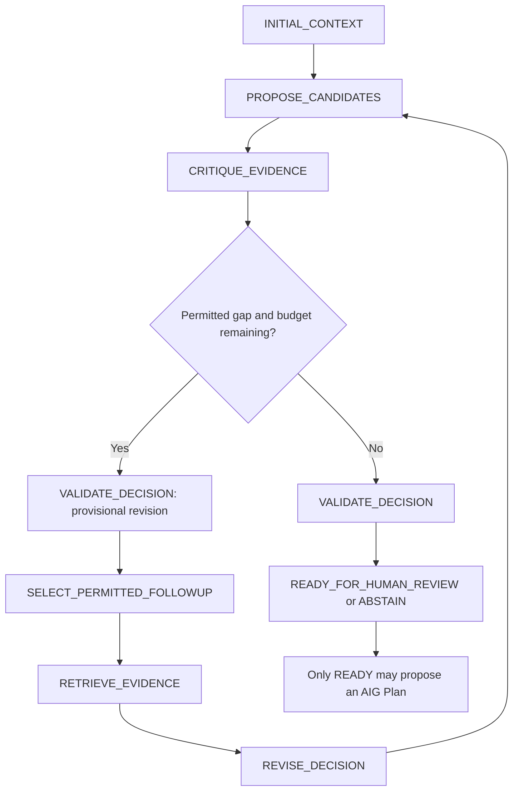

# Implemented bounded reasoning architecture

Status: **PASS offline**. All reasoning and evidence in P1A are deterministic/synthetic. No Nemotron, Meterless or Zetaris execution is claimed.

The implementation is in [reasoning.py](../decisionproof/reasoning.py), [contracts.py](../decisionproof/contracts.py), [sources.py](../decisionproof/sources.py), and [ledger.py](../decisionproof/ledger.py).

Functional roles are separate functions/interfaces, not four LLM agents. The proposer compares candidates; the independent critic checks raw active evidence for absence, disagreement and age; the retrieval planner selects a typed intention; the independent validator checks references, facts and action eligibility. Future async proposal/intention providers are bounded by the same trusted deadline and validation. No orchestration framework, generic tool router or executable model code exists.

The adaptation is real control flow: missing/conflicting/stale inventory chooses `asset_details(asset_id)`; missing maintenance chooses `maintenance_context(asset_id)`; sufficient context skips retrieval; failed/unpermitted queries or exhaustion cause abstention. The engine does not inspect scenario IDs, expected outcomes or a scripted “reverse recommendation” flag. Fixture responses are predetermined synthetic data, clearly labeled; which permitted query is chosen depends on the current critique.

| Bound | Implemented value / enforcement |
|---|---|
| Follow-up rounds | Maximum 2; at most 3 proposal/critique revisions per run |
| Overall reasoning deadline | Trusted offline profile ≤3 seconds, monotonic; async work uses remaining-time timeout; expired results cannot publish READY |
| Queries | Two literal names; existing asset tied to an actual compatible gap; no SQL, URLs or code |
| Batch | ≤16 records, ≤32 KiB canonical JSON; wrong asset/field rejected |
| Snapshot | ≤80 records, ≤128 KiB; strict types, allowed provenance, unique IDs, validated supersession |
| Candidate proposal | Tuple of ≤16 strict Candidate objects; invalid schema/citation becomes ABSTAIN |
| Freshness | Inventory older than 30 days or from after the snapshot's as-of time is insufficient |
| Terminal conditions | No relevant product, unresolved/tied priority, missing/conflicting/stale required context, refused retrieval, deadline or exhausted rounds → ABSTAIN; otherwise READY |

SQLite operations are synchronous and bounded by local lock timeouts; Python cannot preempt a blocking host write. The deadline is fail-closed publication authority, not a hard real-time scheduling guarantee. Future live inference needs a separately reviewed read-only timing profile; this does not extend AIG's five-second action budget.

Full-context offline priority is severity + 3 × business importance + 6 for observed exposure. Missing/conflicting values add no corresponding score and are labeled unknown; they are not treated as proven false. Critique still blocks an executable decision until relevant gaps are resolved. An exact product match only establishes investigation relevance. Installed-version vulnerability stays unconfirmed; the fictional `CVE-2099-0001` is a synthetic fixture identifier. No real CISA membership is asserted.

All relevant candidates must have product/severity, version, exposure, importance and maintenance context without unresolved conflicts; this conservative policy can abstain even when a lower-ranked candidate is incomplete. Equal scores require abstention. These are documented product heuristics, not validated optimal risk estimates.

Each intermediate revision, critique, acquisition attempt and short state summary is persisted. No hidden chain-of-thought or mutable LLM memory is stored. [Tests](../tests/test_contract_security.py) exercise schema rejection, unpermitted intentions, batch bounds, invalid receipt identity and conflict-preserving Delta; [product tests](../tests/test_product.py) cover real loops and deadline refusal.
