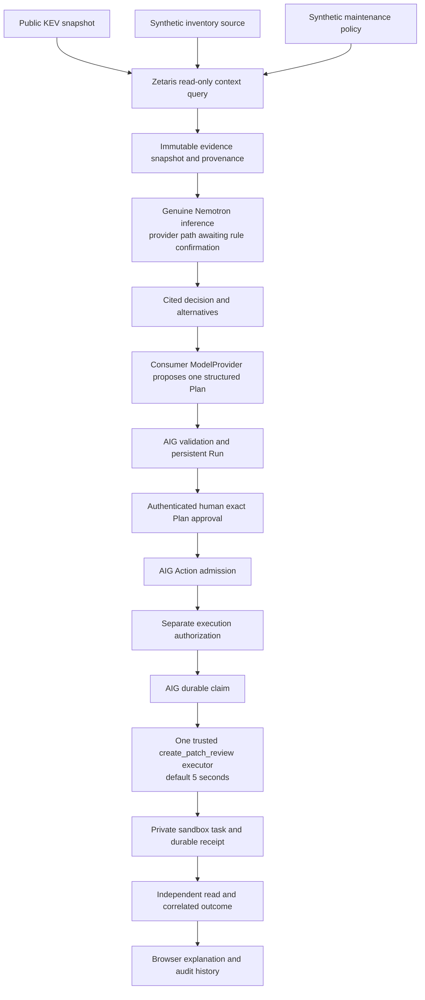

# System architecture — P1 design, NOT IMPLEMENTED

Status: **PASS for preparation design; implementation/browser/provider outcome NOT_RUN**. Product: DecisionProof Agent, Patch Review slice. [Dependency qualification](AIG_V020_DEPENDENCY_VERIFICATION.md) governs the public API boundary. R-01 blocks final sponsor-route selection.

## Smallest deployable composition

One Python 3.13 process, FastAPI and Uvicorn, SQLite, plain server-served HTML/CSS/JavaScript. Existing AIG dependencies already install FastAPI/httpx/Uvicorn; P1 should declare the consumer's direct dependencies explicitly and retain lockfile pinning. No React build, Node server, vector service or new orchestration framework is needed. Node/npm are available if later justified. AIG's bundled demo browser controls are unsuitable for arbitrary tools; build the consumer UI.

Use consumer-owned FastAPI endpoints around the public runtime objects, with one long-lived `open_runtime` context and a single worker holding the owner fence. Do not publicly mount the bundled Runtime app: its Run approval endpoint is not authenticated human consent for this product. Normal startup cannot blindly attest `predecessor_stopped=True`; operator-controlled recovery must establish the previous owner has stopped. P0's separate synthetic processes were sequential and private.

## Data and provenance design

| Consumer record (planned) | Essential fields |
|---|---|
| Source snapshot | source ID/URL, primary owner, license, fetched UTC, content SHA-256, original field path, catalog/version, synthetic flag |
| Asset context | synthetic asset ID, vendor/product, reported version or unknown, exposure state, business importance, maintenance constraints, freshness |
| Evidence item | immutable snapshot ID, row ID, normalized fact, source path, captured UTC, digest, trust/uncertainty label |
| Decision | UUID, evidence-set digest, provider/model identity, safe request ID, short rationale, cited claim IDs, alternatives, uncertainty, proposed task |
| Task and receipt | UUID task/receipt, AIG effect key, complete payload digest, exact binding/scope, decision ID, evidence digest, creation time |

Store source evidence and decisions separately from AIG's private gate database. Preserve immutable snapshots: new retrieval/reasoning produces a new decision and Plan, requiring fresh consent. Never rewrite the context underlying an approved Plan. KEV provides exploitation membership, not comprehensive version ranges or proof a particular device is vulnerable. Version applicability stays unconfirmed unless authoritative evidence is actually retrieved.

## Sponsor adapters and reasoning

`ZetarisContextClient` is a planned read-only consumer component, not an AIG tool. Use assigned tenant contract and scoped read access; fixed parameterized query templates, bounded row/page counts, connect/read/overall timeouts and explicit close. No model-generated SQL, arbitrary URLs or source registration from a prompt. P1 must set up at least two genuinely distinct sources in Zetaris (KEV versus synthetic inventory/policy) and demonstrate one material query across them. Ingestion/tenant writes must remain in authorized P1 setup scope.

Normalize the result into a bounded evidence packet. Treat source strings as data, reject embedded instructions, and keep private information out. Nemotron's meaningful task is to compare exploitation context, exposure, operational constraints and missing information, then justify one review priority with cited alternatives. A keyword-only severity sort is the evaluation baseline, not a sufficient reasoning demonstration. Use concise user-facing reasons, not raw hidden chain-of-thought exports.

`NemotronDecisionProvider` is planned. Endpoint, model identifier and version remain unset until rules/access confirmation. No silent provider/model fallback. `meterless/*` routing IDs need independent underlying-model evidence. Keep provider retries off for the initial evidence-bearing run; report timeout/429/truncation explicitly. Inference belongs before Action execution and may have a separate bounded request timeout; it does not consume or increase the AIG adapter budget.

The consumer `ModelProvider.generate_plan(intent, *, tools, plan_schema, timeout_seconds)` must return the actual strict proposal JSON for the pinned capability. Bind a persisted decision/evidence snapshot to a server-controlled request context; a client-supplied decision ID alone is not authority. Do not secretly replace an invalid model proposal with a hand-authored success Plan. Host constants constrain tool/target identity; AIG validates the resulting proposal. If planning or schema validation fails, display refusal and create no Action.

## AIG integration and trusted tool

At startup, trusted code provisions once and retains a UUIDv4 scope, reviewed `ToolBinding`, capability, registry, verifier, policy revision, gate path and separate effect-store identity. Proposed identity: `create_patch_review/1`, adapter `local-review-queue`, revision `patch-review-v1`, target `sandbox-maintenance-queue`; these names are design candidates, not registered P0 capabilities. The model/browser cannot set credentials, paths, scopes, revisions, budgets, principals or grants.

Proposed arguments are a flat closed object with **all** fields required: `asset_id` (bounded 1–64), `cve_id` (bounded 1–32), `decision_id` (36-character canonical UUID), `evidence_digest` (64 lowercase hex). Tool schema/semantic checks enforce exact types, bounds and digest/decision association; no nested evidence arrays or optional defaults enter AIG. Evidence and rationale live in the immutable decision store. Test canonical total byte limits; do not assume character limits enforce byte limits. Model authority fields and unknown arguments must fail validation.

Use `ToolBinding`, `ToolCapability`, `ExecutableRegistry`, `CapabilityVerifier`, `BoundCapabilityAuthorization` and `open_runtime` from the installed public module. The runtime's `run_service.create/decide`, `gateway.admit/authorize/execute` are the verified integration points; exact signatures are in evidence. Returned versions drive optimistic commands. Preserve the runtime's approved Plan binding, durable claim, CAS, effect identity, command replay and owner fencing. No core internals, duplicated compiler or custom execution engine.

The only executor creates one sandbox review task. Revalidate complete trusted binding, canonical arguments and approved decision association. Within the default 5 seconds, use a bounded SQLite transaction in the consumer store to bind effect key + payload digest + task + unique receipt; read back through an independent read-only connection and compare all correlations before returning a public `ToolOutcome`. Concurrent/conflicting attempts must never create extra tasks. This consumer transaction is business task/receipt storage, not a replacement for AIG claiming. AIG gate/consumer store are distinct transactions; uncertain commits or late/uncorrelated outcomes remain **Unknown** with no automatic retry/reconciliation.

## Human identity and separate gates

Single named owner session for the first local demo: server-verified password/secret stored outside source, signed expiring HttpOnly/SameSite cookie, CSRF token and Origin validation, localhost binding. Keep capabilities entirely server-side. Map authenticated identity to the configured verifier-issued principal; never trust HTTP `subject_id` or expose the capability bearer token to JavaScript.

Protect all Run creation/read/approval and Action routes. Present exact Plan, evidence digest, task destination and synthetic-data labels before **Approve Plan**. Admission uses that approved persistent Run. A separate **Authorize Action** operation records execution permission under the policy, followed by an explicit **Execute once** operation. Approval never calls execution. Reusing the same authenticated person is acceptable for the single-owner demo only when these remain separate persisted decisions; production multi-user/RBAC is deferred and must not be claimed.

Recheck freshness/decision identity before admission and before dispatch. If product-relevant context changed, fail closed and create a new decision/Plan/approval rather than modifying an approved task. Only explicit read-only inspection may show historical Unknown; never turn it into success by replaying the effect.

## UI and verification

Three connected screens: (1) evidence/asset comparison with source links, UTC age and synthetic labels; (2) decision/alternatives with exact Plan and separate approval/authorization controls; (3) durable task/receipt/audit view that survives reload. Show provider/data status, empty/error/denied/Unknown states, and clear text that the action is a sandbox review task. Keyboard access, readable contrast and loading/failure states are acceptance requirements.

Test actual installed-package Plan→Run→Approval→Admission→Authorization→claim→task→verified receipt, plus wrong tool/target/binding/scope, stale approval, unauthorized HTTP, CSRF, duplicates, concurrency, payload conflicts, malicious evidence, missing citations, changed snapshot and ambiguous commit. Run child-process interruption/recovery and prove no second task. Use deterministic providers for offline tests; collect separate real Zetaris + Nemotron traces and browser evidence. P0's five dependency checks do not satisfy these product tests.

## Deployment plan

First deliver localhost with a private persistent directory on D:, one worker and explicit lifecycle ownership. Public hosting is **UNVERIFIED as a requirement**, not performed or authorized. If required later, prepare a reviewable single-instance deployment with HTTPS, authenticated routes, server-only secrets and persistent private storage; validate restart semantics and budget before asking for final publishing approval. Do not use an ephemeral filesystem, public anonymous execution, multiple workers or external cloud/ticket writes for convenience. No extended-budget profile is planned.
